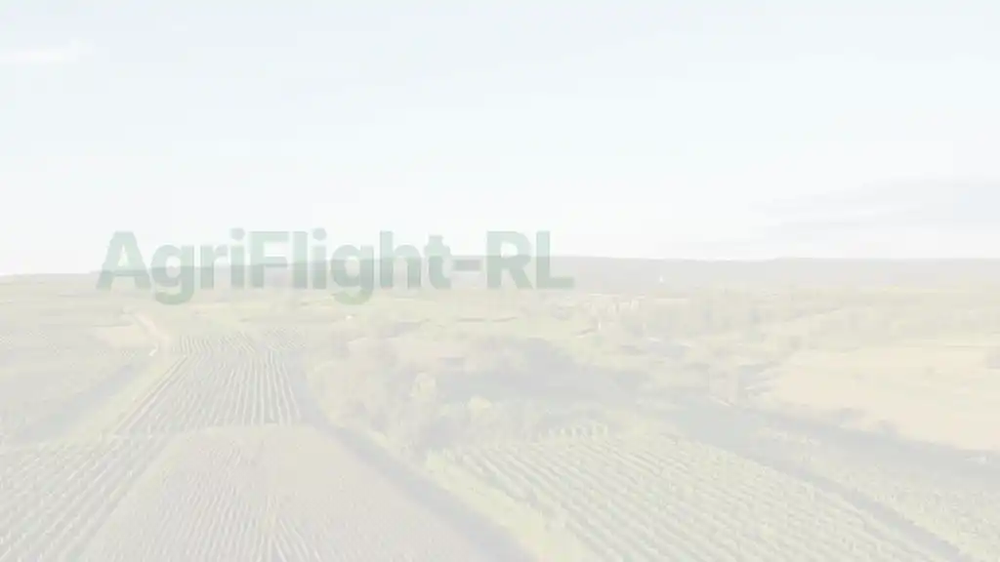
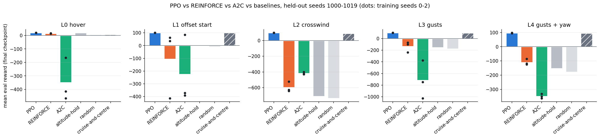

# AgriFlight-RL

[](https://www.python.org/)
[](https://mujoco.org/)
[](https://gymnasium.farama.org/)
[](https://pytorch.org/)
[](notebooks/)

**AgriFlight-RL** is a reinforcement-learning benchmark for precision-agriculture flight: a simulated Skydio X2 quadrotor has to fly 1.2 m above an 8 m crop row, stay over its centreline and reach the end of the row while wind pushes it off course. The task is a custom Gymnasium environment (`AgroDrone-v0`) on MuJoCo with five difficulty levels, from windless hover to gusting wind with free yaw. Three policy-gradient methods (**REINFORCE**, **A2C** and **PPO**) are compared on the same environment, reward, seeds and evaluation protocol, against hand-coded baselines. **PPO clears all five levels in every training seed with 0% crashes** and matches or beats a hand-designed cruise-and-centre controller from L1 to L4.

---

## 🎬 Demo

[](https://media.nelkit.dev/projects/demos/rl-assignment-3-video-demo.mp4)

[](https://media.nelkit.dev/projects/demos/rl-assignment-3-video-demo.mp4)

---

## Table of Contents

- [🧭 Overview](#-overview)
- [🏗️ System Architecture](#️-system-architecture)
- [🚀 Local Setup](#-local-setup)
- [🔐 Environment Variables](#-environment-variables)
- [💻 Usage](#-usage)
- [🧪 Testing and Evaluation](#-testing-and-evaluation)
- [🤖 Environment and Algorithms](#-environment-and-algorithms)
- [📊 Results](#-results)
- [🔄 Scripts](#-scripts)
- [⚠️ Known Limitations](#️-known-limitations)
- [🛠️ Troubleshooting](#️-troubleshooting)
- [👥 Team](#-team)
- [🔗 Links](#-links)
- [📄 Licence and Attribution](#-licence-and-attribution)

---

## 🧭 Overview

- **Subject:** 43008 Reinforcement Learning, University of Technology Sydney (Spring 2026)
- **Assessment:** Assessment 3, Mini Project (team **LMF, "Let me fly"**, Project #22)
- **Scope:** a 3D MuJoCo environment for crop-row flight under wind, three policy-gradient agents implemented from scratch in PyTorch, hand-coded baselines, a shared evaluation harness and an interactive 3D viewer
- **Demo video:** [4:41 walkthrough](https://media.nelkit.dev/projects/demos/rl-assignment-3-video-demo.mp4)

**How it fits together.** At every step the environment returns a 14-D observation (altitude error, lateral offset, orientation, velocities and wind). The policy outputs four normalised velocity commands, and a fixed inner PD controller turns them into rotor thrusts, so the agent learns to correct drift rather than to keep the drone airborne. Each algorithm is trained at every level (L0–L4) on seeds 0, 1 and 2 for 1M steps, with a checkpoint about every 100k steps. Every checkpoint is evaluated deterministically on the held-out seeds 1000–1019, results are written to a shared JSON schema, and `notebooks/comparison.ipynb` turns them into the comparison tables and plots. The viewer replays any saved PPO checkpoint over a visual-only vineyard scene.

---

## 🏗️ System Architecture

```text
 TRAINING LOOP  (per algorithm × level L0–L4 × seed 0, 1, 2)
 ┌──────────────────────────────────────────────────────────────────────────┐
 │                                                                          │
 │  ┌──────────────────────┐  obs (14)   ┌──────────────────────────────┐   │
 │  │ AgroDrone-v0         │ ──────────► │ Gaussian policy  64-64 tanh  │   │
 │  │ MuJoCo · Skydio X2   │             │ (REINFORCE · A2C · PPO)      │   │
 │  │ wind · shared reward │             │ + critic V(s)  (A2C, PPO)    │   │
 │  └──────────────────────┘             └──────────────┬───────────────┘   │
 │        ▲ rotor thrusts (4)                           │ action (4) ∈ [-1,1]│
 │        │                                             ▼                   │
 │  ┌─────┴────────────────────┐         ┌──────────────────────────────┐   │
 │  │ Inner PD controller      │ ◄────── │ ACTION_SCALE                 │   │
 │  │ velocity → attitude →    │         │ ±2 m/s, ±1 m/s, ±1 m/s,      │   │
 │  │ thrust mixer (fixed)     │         │ ±1 rad/s                     │   │
 │  └──────────────────────────┘         └──────────────────────────────┘   │
 └───────────────────────────────────────┬──────────────────────────────────┘
                                         │ checkpoints every ~100k steps + final
                                         ▼
 EVALUATION AND COMPARISON
 ┌──────────────────┐   ┌────────────────────────┐   ┌────────────────────┐
 │ Hand-coded       │──►│ evaluate()             │──►│ results/*.json     │
 │ baselines        │   │ deterministic, held-out│   │ (shared schema)    │
 └──────────────────┘   │ seeds 1000–1019        │   └─────────┬──────────┘
                        └────────────────────────┘             ▼
 ┌──────────────────┐                              ┌────────────────────────┐
 │ scripts/viewer.py│ ◄── PPO checkpoint (.pt)     │ comparison.ipynb       │
 │ MuJoCo 3D viewer │                              │ tables + figures       │
 └──────────────────┘                              └────────────────────────┘
```

| Path | Role |
| ---- | ---- |
| `src/agroflight/envs/` | `AgroDroneEnv`, inner controller, Gymnasium registration, vineyard scene builder and assets |
| `src/agroflight/baselines/` | `altitude_hold`, `random_policy` and `cruise_and_centre` controllers |
| `src/agroflight/training/` | `train_reinforce.py`, headless and restartable REINFORCE runs for L0–L4 |
| `src/agroflight/evaluation/` | `evaluate()`, the evaluation every notebook uses |
| `src/agroflight/policies.py` | `load_policy()`, rebuilds a trained policy from a checkpoint |
| `notebooks/` | One notebook per algorithm (PPO, REINFORCE, A2C) and `comparison.ipynb` |
| `results/` | Result JSONs per algorithm and per run, comparison CSV/JSON and figures; `archive/` holds superseded runs |
| `scripts/` | `viewer.py`, `assemble_reinforce_results.py`, `gltf_to_obj.py` |
| `tests/` | `test_env.py` and `test_baselines.py` |
| `docs/` | `sagemaker_setup.md`, the guide for running the notebooks on AWS SageMaker |

---

## 🚀 Local Setup

### Before you start

| Requirement | Why |
| ----------- | --- |
| **Python 3.11** | `pyproject.toml` requires `>=3.11`, `make setup` creates the venv with `python3.11`, and the pinned versions in `requirements.txt` (e.g. gymnasium 1.4.0) do not install on 3.10 |
| `git` | Sparse-clones the Skydio X2 model from MuJoCo Menagerie |
| `make` | Runs the setup, test and viewer targets (preinstalled on macOS/Linux; on Windows use WSL) |

### Clone the repository

```bash
# SSH
git clone git@github.com:Nelkit/agroflight-rl.git
# or HTTPS
git clone https://github.com/Nelkit/agroflight-rl.git

cd agroflight-rl
```

### Python environment and drone model

**Step 1 — Create the venv and install the package** *(required)*

```bash
make setup
```

Creates `.venv/`, installs the package in editable mode with the `train` and `dev` extras, and stamps `.venv/.installed` so it only reinstalls when `pyproject.toml` or `requirements.txt` changes.

**Step 2 — Fetch the drone model** *(required)*

```bash
make menagerie
```

The Skydio X2 model is **not vendored**. This sparse-clones only `skydio_x2/` from [`mujoco_menagerie`](https://github.com/google-deepmind/mujoco_menagerie), a few MB instead of the full multi-GB repository.

**Step 3 — Check the installation**

```bash
make test      # every test should pass
make viewer    # opens a window with the drone over the crop rows
```

`make help` lists every target.

<details>
<summary><b>Manual installation (without make)</b></summary>

```bash
python3.11 -m venv .venv
source .venv/bin/activate          # Windows (PowerShell): .venv\Scripts\Activate.ps1
pip install --upgrade pip
pip install -e ".[train,dev]"      # or the pinned set: pip install -r requirements.txt
make menagerie
export AGRO_DRONE_XML=$(pwd)/mujoco_menagerie/skydio_x2/x2.xml
```

Dependency groups in `pyproject.toml`, so the environment and tests can be installed without PyTorch:

| Group | Install with | Contents | Needed for |
| ----- | ------------ | -------- | ---------- |
| core | `pip install -e .` | `mujoco`, `gymnasium`, `numpy` | The env, the baselines, the viewer |
| `train` | `pip install -e ".[train]"` | `torch`, `matplotlib`, `pandas` | The notebooks (training, evaluation, plots) |
| `dev` | `pip install -e ".[dev]"` | `pytest` | `make test` |

`pyproject.toml` lists the dependencies unpinned; `requirements.txt` pins the exact versions used (plus `ipykernel` and `pillow`).

</details>

### Notebooks on AWS SageMaker or Colab

Open a notebook from a clone of this repo and run cell 2.1 (Bootstrap). It detects the clone, downloads the X2 model and installs whatever is missing. On SageMaker, clone the repo first with a fine-grained GitHub token, as described in [`docs/sagemaker_setup.md`](docs/sagemaker_setup.md). On Colab, the cell clones the repo itself using `GITHUB_TOKEN`.

### Starting over

```bash
make clean        # removes .venv, the menagerie clone, runs/, checkpoints/ and caches
make clean-runs   # removes only runs/, checkpoints/ and wandb/
```

---

## 🔐 Environment Variables

There is no `.env` file. The project reads two variables:

| Variable | Required | Default | Used by |
| -------- | -------- | ------- | ------- |
| `AGRO_DRONE_XML` | Yes, outside `make` | Set by `make`, `train_reinforce.py` and `assemble_reinforce_results.py` to `mujoco_menagerie/skydio_x2/x2.xml` | `AgroDroneEnv` and `evaluate()` to locate the drone model |
| `GITHUB_TOKEN` | Colab only | none (Colab Secrets or a hidden prompt) | Notebook cell 2.1, to clone the repository |

If you run scripts by hand, export the model path yourself:

```bash
export AGRO_DRONE_XML=$(pwd)/mujoco_menagerie/skydio_x2/x2.xml          # bash / zsh
$env:AGRO_DRONE_XML = "$PWD\mujoco_menagerie\skydio_x2\x2.xml"          # PowerShell
```

---

## 💻 Usage

### Use the environment

```python
import gymnasium as gym
import agroflight.envs  # registers AgroDrone-v0

env = gym.make("AgroDrone-v0", level=2)  # the package default level is 3
obs, info = env.reset(seed=0)
obs, reward, terminated, truncated, info = env.step(env.action_space.sample())
```

### Viewer (interactive 3D demo)

```bash
make viewer                                        # altitude-hold baseline
make viewer ARGS="--policy random"                 # random baseline
make viewer ARGS="--checkpoint path/to/ckpt.pt"    # trained PPO policy
```

A native MuJoCo window where you can orbit, pan, zoom and pause. A blue arrow shows the wind force on the drone, and its lateral and vertical components appear in the top-left corner. Episodes restart automatically, and each outcome (crashed, finished row or timed out) is printed in the terminal.

| Option | Default | Meaning |
| ------ | ------- | ------- |
| `--policy` | `altitude-hold` | Hand-coded baseline: `altitude-hold` or `random` |
| `--checkpoint` | none | Trained `.pt` checkpoint; overrides `--policy` |
| `--level` | inferred | Level L0–L4; must match the checkpoint's level, and is inferred from a `_L<k>_` file name |
| `--field-length` | `8.0` | Crop row length (m) |
| `--max-steps` | `1000` | Steps before an episode times out |
| `--seed` | `1` | RNG seed |
| `--drone-dir` | menagerie clone | Folder containing `x2.xml` |

**Best PPO seed per level** (final checkpoint with the highest held-out mean reward):

```bash
make viewer ARGS="--checkpoint notebooks/runs/ppo_25609227/long/checkpoints/ppo_25609227_L0_seed2_final.pt --level 0"  # 19.78
make viewer ARGS="--checkpoint notebooks/runs/ppo_25609227/long/checkpoints/ppo_25609227_L1_seed1_final.pt --level 1"  # 100.34
make viewer ARGS="--checkpoint notebooks/runs/ppo_25609227/long/checkpoints/ppo_25609227_L2_seed2_final.pt --level 2"  # 99.80
make viewer ARGS="--checkpoint notebooks/runs/ppo_25609227/long/checkpoints/ppo_25609227_L3_seed2_final.pt --level 3"  # 99.91
make viewer ARGS="--checkpoint notebooks/runs/ppo_25609227/long/checkpoints/ppo_25609227_L4_seed0_final.pt --level 4"  # 97.95
```

> **Checkpoints are not versioned** (`*.pt` and `runs/` are gitignored). These paths exist only after running the PPO notebook in `long` mode.

### Training

| Algorithm | Where | Owner |
| --------- | ----- | ----- |
| PPO | `notebooks/ppo_25609227.ipynb` | Nelkit Chavez |
| REINFORCE | `notebooks/reinforce_25418551.ipynb`, or headless with `python -m agroflight.training.train_reinforce` | Juan David Rodriguez |
| A2C | `notebooks/a2c_25399217.ipynb` | Panzhao Li |
| Comparison | `notebooks/comparison.ipynb` (reads `results/`, trains nothing) | Team |

The cells marked *Shared, identical in all three notebooks* (results schema, checkpoints, evaluation) must stay identical so the comparison notebook can read all three results files. The environment lives only in `src/agroflight/envs/`: edit the package, never a notebook copy.

---

## 🧪 Testing and Evaluation

### Unit tests

```bash
make test
```

- `tests/test_env.py` (28 tests): registration, `reset()`/`step()` shapes and types, no NaN/Inf over rollouts, action clipping, control inside `ctrlrange`, hover holding altitude and tracking forward and climb commands, leaving the envelope ending as a crash, yaw held unless free, the level definitions, seed reproducibility, and two reward-ordering checks: completing the row beats hovering, and crashing on purpose never beats riding out a bad flight.
- `tests/test_baselines.py` (3 tests): the baseline controllers.

The suite deliberately has **no tests asserting that a trained policy flies well**; performance claims belong in the evaluation. It skips itself if the Skydio X2 model is missing (`make menagerie`).

### Evaluation protocol

Every notebook evaluates through the same helper:

```python
from agroflight.evaluation.evaluate_policy import evaluate
stats = evaluate(policy_fn, seeds=range(1000, 1020), env=env)
```

| Setting | Value |
| ------- | ----- |
| Episodes | 20, on held-out seeds **1000–1019** (fixed before any training) |
| Policy | Deterministic (the Gaussian mean, no exploration noise) |
| Metrics | Mean reward, crash rate, row-completion rate, mean flight steps, mean \|altitude error\| |
| Level cleared | At the **final** checkpoint: ≤ 5% crashes, plus altitude error < 0.05 m at L0, or ≥ 90% of rows completed from L1 on |
| Sample efficiency | Environment steps at the first checkpoint that meets the criterion (100k-step resolution) |

---

## 🤖 Environment and Algorithms

### `AgroDrone-v0`

| Element | Definition |
| ------- | ---------- |
| Observation `(14,)` | `alt_error`, `lateral_offset`, `quat` (4), `linvel` (3), `angvel` (3), `wind` (2: lateral and vertical). The wind is observed, so the MDP is fully observed |
| Action `(4,)` in `[-1, 1]` | Forward velocity, lateral velocity, climb rate, yaw rate, scaled to ±2 m/s, ±1 m/s, ±1 m/s and ±1 rad/s. Yaw rate is used only when `yaw_free=True` (L4) |
| Inner controller | Fixed P loop on velocity over a PD loop on attitude, tilt capped at 35°, no integral term or position loop (`envs/inner_controller.py`) |
| Physics | `dt = 0.01` s, one agent step per physics step, episodes truncated at 1000 steps (10 s) |
| Wind | Steady: a constant lateral force of 0.3–0.6 N per episode. Gusting: a random walk (σ = 0.05 N per step, clipped to ±0.6 N) with a smaller vertical component |

**Reward** (shared by all algorithms; every weight is configurable through `RewardConfig`):

```text
reward = −(2·alt_error² + 2·lateral_offset² + 0.5·tilt² + 0.01·|action|²)
         + 10 · (metres gained along the row)
         + 0.02                   survival bonus, per step
         − 300                    if crashed
         + 20                     if the row was completed
```

Progress and completion apply from L1 on. The crash penalty was raised from 50 to 300 because, at 50, crashing on purpose scored better than flying through the wind from L2 on; a regression test now checks it never does.

**Difficulty levels** (fixed in Part B and never tuned per algorithm; `gym.make("AgroDrone-v0", level=k)`):

| Level | Wind | Spawn | Task |
| ----- | ---- | ----- | ---- |
| L0 | None | On the row | Hold 1.2 m altitude (no progress reward) |
| L1 | None | ±0.15 m offset | Follow the row |
| L2 | Steady side wind | ±0.15 m offset | Follow the row |
| L3 | Gusting (random walk) | ±0.15 m offset | Follow the row |
| L4 | Gusting (random walk) | ±0.15 m offset | Follow the row, yaw rate free |

**Termination:** crash on `z < 0.08 m`, `tilt > 1.2 rad`, or leaving the ±1 m envelope around the target altitude or the centreline; success when `x ≥ field_length` (L1–L4); truncation at `max_steps`.

<details>
<summary><b>All constructor parameters</b></summary>

| Parameter | Default | Meaning |
| --------- | ------- | ------- |
| `target_altitude` | `1.2` | Target flight height (m) |
| `field_length` | `8.0` | Row length before completion (m) |
| `wind_strength` | `0.6` | Max wind force magnitude (`0.0` disables it) |
| `max_steps` | `1000` | Truncation limit (10 s at `dt = 0.01`) |
| `level` | `3` | Difficulty level L0–L4 |
| `reward_config` | `None` | `RewardConfig` or dict of weight overrides |
| `frame_skip` | `1` | Physics steps per action |
| `yaw_free` | `False` | Let the policy command yaw rate |
| `seed` | `None` | RNG seed for wind and start offset |
| `max_alt_error` | `1.0` | Altitude envelope (m); `None` disables it |
| `max_lateral_offset` | `1.0` | Lateral envelope (m); `None` disables it |

</details>

### Algorithms

All three share the same actor: two hidden layers of 64 tanh units, a linear mean output initialised near zero and a state-independent learnable log-σ. A2C and PPO add a separate critic of the same shape.

| | REINFORCE | A2C | PPO |
| - | --------- | --- | --- |
| Update | 1 gradient step per episode | 1 update per rollout of ≤ 5 steps | 2048-step rollout, 10 epochs × 32 minibatches of 64 |
| Optimiser | Adam, 3e-4 | Adam, 1e-4 | Adam (ε 1e-5), 3e-4 → 0 linear |
| Advantage | Discounted return, no baseline | Return − V(s) | GAE (γ 0.99, λ 0.95), normalised per minibatch, clip ε 0.2 |
| Initial σ | 0.1 | ≈ 0.1 | 1.0 |
| Shared | γ 0.99 · entropy bonus 0 · crash penalty 300 · 1M steps × 3 seeds per level · value coef 0.5 and grad norm 0.5 where a critic exists |

PPO was written from scratch in PyTorch following the [CleanRL](https://github.com/vwxyzjn/cleanrl) single-file design, because the pip release of CleanRL targets the old Gym API. Hyperparameters were set at L0 and kept fixed for L0–L4 for every algorithm.

### Baselines

| Baseline | Behaviour |
| -------- | --------- |
| `random` | Uniform random actions at 30% of the range: the sanity floor |
| Zero action | Hover in place (evaluated in the notebooks) |
| `altitude_hold` | Proportional controller that holds altitude, ignores drift and progress |
| `cruise_and_centre` | Forward 1.0, lateral `clip(-offset)`, climb from `altitude_hold`, yaw 0. It finishes every row on L1–L4: **the bar to beat** |

---

## 📊 Results

Final checkpoints, mean over training seeds 0–2, evaluated on held-out seeds 1000–1019 (from `results/comparison_summary.csv`).

| Level | PPO | REINFORCE | A2C | Cruise-and-centre |
| ----- | --: | --------: | --: | ----------------: |
| L0 hover | **19.7** | 15.2 | −349.0 | 6.4 |
| L1 offset start | **100.2** | −105.6 | −225.5 | 99.7 |
| L2 crosswind | **99.7** | −598.8 | −418.6 | 90.1 |
| L3 gusts | **99.9** | −135.5 | −716.7 | 95.8 |
| L4 gusts + yaw | **96.3** | −110.1 | −349.3 | 95.6 |

| Method | Highest level cleared | Steps to clear | Crash rate at L1–L4 |
| ------ | --------------------- | -------------- | ------------------- |
| **PPO** | **L4, 3 of 3 seeds** | ~200k at L1–L3, ~500k at L4 (median) | 0% |
| REINFORCE | L0 in 3 of 3 seeds; L1 in seed 0 only | 100k at L0, 200k at L1 | 0–35% |
| A2C | L1 in seed 1 only | 800k | 67–100% |

[](results/figures/comparison_reward_by_level.png)

PPO beats cruise-and-centre at every level from L1 to L4, by a small margin (+0.4 to +4.1) except under the steady crosswind (+9.7 at L2). It finishes the 8 m row in about 4.3 s at L1–L3 and 4.1 s at L4. More figures are in [`results/figures/`](results/figures/).

| File | Contents |
| ---- | -------- |
| `results/ppo_25609227.json`, `reinforce_25418551.json`, `a2c_25399217.json` | Results per algorithm (shared schema) |
| `results/ppo/runs/`, `results/reinforce/runs/`, `results/a2c_25399217_L*_seed*_*.json` | Per-run results: hyperparameters, learning curve and evaluation of every checkpoint |
| `results/reinforce_normret/runs/` | REINFORCE standardised-returns ablation (L1, L2) |
| `results/comparison.json`, `results/comparison_summary.csv` | Cross-algorithm comparison from `notebooks/comparison.ipynb` |
| `results/figures/` | Comparison and per-algorithm figures |

---

## 🔄 Scripts

Run them from the repo root with the venv active. They set `AGRO_DRONE_XML` themselves if it is missing.

```bash
# REINFORCE headless training → checkpoints/reinforce/L{n}_seed{s}/, results/reinforce/runs/
# Restartable: a run is skipped when its final.pt and run JSON already exist.
python -m agroflight.training.train_reinforce --levels 0 1 2 3 4 --seeds 0 1 2 --workers 4
#   --steps 1000000  --ckpt-every 100000  --normalize-returns

# Per-run REINFORCE JSONs → results/reinforce_25418551.json (no retraining; re-runs the baselines)
python scripts/assemble_reinforce_results.py

# glTF plant model → Z-up OBJ meshes + PNG texture for the viewer scene
python scripts/gltf_to_obj.py scene.gltf src/agroflight/envs/assets/grapevine \
    --name grapevine --target-triangles 12000    # --target-triangles needs fast-simplification
```

---

## ⚠️ Known Limitations

- **Sim-to-real gap.** No rotor ground effect or canopy turbulence, exact observations without noise or latency, and wind as a single external force that the policy observes directly, which a real drone would have to estimate.
- **Controller dependence.** The inner PD controller has no integral term or position loop and caps tilt at 35°; the task difficulty, and so the results, are tied to that design.
- **Ceiling effect.** PPO clears every level with 0% crashes, so the benchmark cannot separate it from stronger methods. L0 is saturated and the row is only 8 m.
- **Unequal initial σ and limited tuning.** PPO starts at σ = 1 and the others at ≈ 0.1; hyperparameters were set at L0 rather than tuned at L2, and A2C had no full search.
- **Small statistics and coarse sample efficiency.** 3 training seeds × 20 evaluation episodes, with checkpoints every ~100k steps.
- **Final-checkpoint reporting.** It penalises unstable runs: REINFORCE at L1 and A2C seed 1 at L3 had better earlier checkpoints.
- **Viewer replays PPO only.** REINFORCE and A2C checkpoints are not in the repository and use a different format, so the three-policy side-by-side viewer planned in Part B was not built; the algorithms are compared through the plots.
- **Reward sensitivity.** Even with a crash penalty of 300 the margin is narrow (hovering through the wind costs about −297), and the planned reward-weight sensitivity analysis was not run.

---

## 🛠️ Troubleshooting

| Symptom | Cause | Fix |
| ------- | ----- | --- |
| All tests skipped | Drone model not cloned | `make menagerie` |
| `ValueError: No xml_path given and AGRO_DRONE_XML env var not set` | Running a script outside `make` | `export AGRO_DRONE_XML=$(pwd)/mujoco_menagerie/skydio_x2/x2.xml` |
| `.venv/bin/mjpython: Permission denied` or `No such file or directory` on macOS | The venv's interpreter path is broken (the project moved, or the path has a space) | `rm -rf .venv && make setup` |
| Viewer exits immediately on macOS | MuJoCo's viewer must own the main thread | Use `make viewer`, not `python scripts/viewer.py`; the Makefile selects `mjpython` |

---

## 👥 Team

| Member | Primary contributions |
| ------ | --------------------- |
| **Nelkit Isael Chavez Calona** (25609227) | **PPO** from scratch (CleanRL design), L0 validation and L0–L4 × 3 seeds runs on AWS SageMaker; ±1 m flight envelope; SageMaker setup for the notebooks; checkpoint replay in the viewer and the vineyard scene; team repository |
| **Juan David Rodriguez Arciniegas** (25418551) | **REINFORCE** and the shared Gaussian policy; first version of `AgroDrone-v0` (action space, inner controller, reward, levels L0–L4); crash-penalty fix and regression test; restartable `train_reinforce.py`; standardised-returns ablation |
| **Panzhao Li** (25399217) | **A2C** with independent actor and critic; Part C configuration study; L0–L4 × 3 seeds runs with periodic, best and final checkpoints; shared evaluation process; unified budget proposal for a fair comparison |

---

## 🔗 Links

- [Demo video (4:41)](https://media.nelkit.dev/projects/demos/rl-assignment-3-video-demo.mp4)
- [MuJoCo](https://mujoco.org/) · [Gymnasium](https://gymnasium.farama.org/) · [MuJoCo Menagerie: Skydio X2](https://github.com/google-deepmind/mujoco_menagerie/tree/main/skydio_x2)
- [CleanRL `ppo_continuous_action.py`](https://github.com/vwxyzjn/cleanrl/blob/master/cleanrl/ppo_continuous_action.py)
- [SageMaker setup guide](docs/sagemaker_setup.md) · [Notebooks guide](notebooks/README.md)

---

## 📄 Licence and Attribution

This repository has no licence file. Third-party material:

- **Drone model:** Skydio X2 from [`mujoco_menagerie`](https://github.com/google-deepmind/mujoco_menagerie) (Google DeepMind, Apache-2.0), fetched at setup time and not vendored.
- **PPO:** follows the design of [CleanRL](https://github.com/vwxyzjn/cleanrl)'s `ppo_continuous_action.py` (MIT).
- **Viewer scene:** based on ["Day 219: Grapevine plant - 1scanaday"](https://sketchfab.com/3d-models/day-219-grapevine-plant-1scanaday-f59fa3cd369941af8bab9716aac768e2) by [emm](https://sketchfab.com/edemaistre), licensed under [CC BY 4.0](http://creativecommons.org/licenses/by/4.0/). Changes are listed in `src/agroflight/envs/assets/grapevine/README.md`.

---

<p align="center"><sub>43008 Reinforcement Learning | Assessment 3 · Team LMF | University of Technology Sydney · Spring 2026</sub></p>
